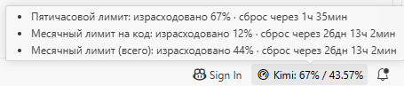

# Kimi Limits

[](https://github.com/vlaved/kimi-limits)

Расширение для VS Code, показывающее израсходованные лимиты тарифа Kimi (Moonshot AI) в статус-баре.

## Пример работы



## Возможности

- Статус-бар в формате `Kimi: 8% / 36.33%` — израсходовано пятичасового окна и месячной квоты (всего), месячный процент с точностью до сотых.
- Подсказка с деталями по каждому лимиту и времени сброса (локальный часовой пояс, 24-часовой формат `ДД.ММ.ГГГГ ЧЧ.ММ`).
- Поддержка форматов ответа:
  - ключи подписки `sk-kimi-...`: окна `limit_5h`, `limit_7d`, `limit_month_total`, `limit_month_code` (недокументированный формат API, может меняться);
  - классический формат: поля `usage`, `totalQuota`, массив `limits[]` с `detail`;
  - массивы `limits`/`quotas` и объекты вида `{ ключ: { used, total } }`.
- Автообновление с настраиваемым интервалом, предупреждение при израсходовании > 80%.

## Настройка

1. Получите API-ключ в Kimi Code Console (раздел управления API Keys).
2. В VS Code выполните команду **«Kimi Limits: Set API Key»** (Ctrl+Shift+P) — ключ сохранится в защищённом хранилище.
3. При необходимости измените эндпоинт в настройке `kimiLimits.endpoint`.

### Настройки

| Ключ | По умолчанию | Описание |
|---|---|---|
| `kimiLimits.endpoint` | `https://api.kimi.com/coding/v1/usages` | URL эндпоинта с лимитами |
| `kimiLimits.apiKey` | `""` | Ключ напрямую (не рекомендуется — используйте secret storage) |
| `kimiLimits.refreshIntervalMinutes` | `5` | Интервал автообновления, мин |
| `kimiLimits.showInStatusBar` | `true` | Показывать сводку в статус-баре |

## Команды

- `Kimi Limits: Refresh` — обновить данные вручную.
- `Kimi Limits: Set API Key` — сохранить ключ.
- `Kimi Limits: Clear API Key` — удалить ключ.

## Запуск из исходников

```bash
cd kimi-limits
npm install
# откройте папку в VS Code и нажмите F5
```

Или соберите `.vsix` и установите через «Extensions: Install from VSIX»:

```bash
npx vsce package
```
